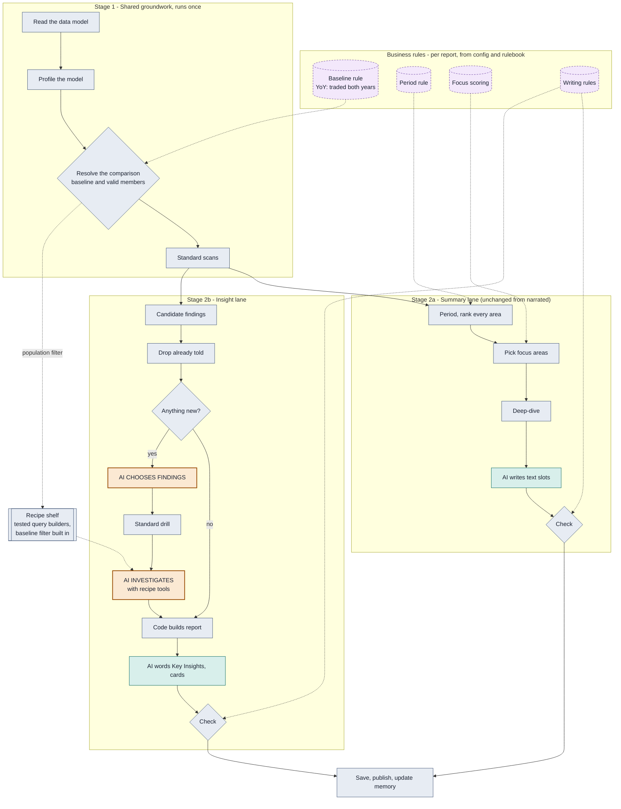
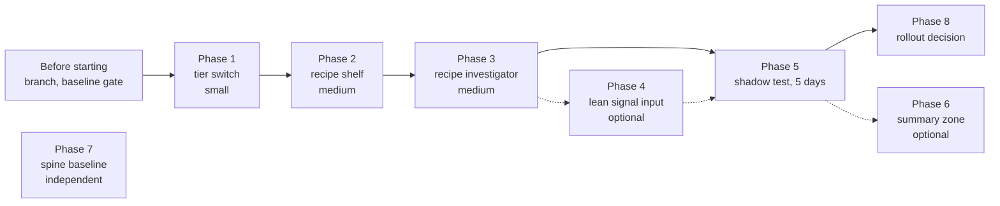

# Reasoned tier: implementation plan

A fourth value for `report_ai_tier`, called `reasoned`, built **alongside** the three that
exist. In it the AI makes decisions in exactly two places, choosing findings and
investigating them, and writes wording in the slots the narrated tier already has.
It never writes DAX in the normal path: it picks from a shelf of tested query recipes and
code builds the query. `investigated`, `narrated` and `deterministic` are not changed, and
no existing config changes behaviour.

Pilot: SB Mart Sales YoY (`config/sbmart-yoy/`), which runs `narrated` today.

Read first: `docs/cost-and-tiering-implementation-brief.md` (the tiers, the measured costs,
the ground rules in its section 3), `src/tools/ai_tier.py`, `scripts/replay_ai_tier.py`.

---

## 1. Target design

What each tier does at each AI touchpoint after this plan:

| Step (module) | investigated | narrated | deterministic | **reasoned (new)** |
|---|---|---|---|---|
| Describe report (`report_understanding`) | AI | code | code | code |
| Plan + write summary DAX (`dax_planner`, `dax_generator`) | AI | skipped | skipped | skipped |
| Choose findings (`insight_signal_detector`) | AI | code (score) | code | **AI** |
| Investigate (`insight_investigator`) | AI writes DAX | code trail | code trail | **AI picks recipes; custom DAX last resort** |
| Insight report (`insight_synthesizer`) | AI writes all | code + AI Key Insights | code | code + AI Key Insights |
| Summary, dashboard, KPI card wording | AI | AI slots | code | AI slots |

The graph topology does not change. No node is added to `NODE_FACTORIES`; the new
investigator is dispatched from inside `insight_investigator.run`, so the fork, routers and
joined barrier (concurrency contract) are untouched.

**Seams.** None of S1-S5 is crossed as long as the published payloads keep their shape
(`kpi_insights.json`, `report_summary.json`/`.html`, history entries, `highlights.json`).
Phase 1's replay asserts that. If any phase ever needs a payload change, stop and run
`/impact` first: it becomes a three-repo change.

---

## 2. Ground rules (from the cost brief, section 3, restated for this work)

1. Off by default. No existing config sets `reasoned`, so nothing changes until a config opts in.
   Every new key is read only under `reasoned`.
2. Every new key goes into `src/config_schema.py` with label, help, detail and tier.
3. `src/kernel/` never imports from `src/domains/`.
4. Do not touch the fork, the routers or the joined barrier. Logs return only the node's delta.
5. A cheaper model only where a deterministic check would reject a worse answer.
6. Never make a saving by weakening a validator.
7. Every new module gets a `scripts/replay_*.py`; raise `MIN_EXPECTED` (55 today) to match.
8. Measure, do not assume: `token_usage.json` for cost, the audit scripts for correctness.

Exit criterion for **every** phase: `python scripts/replay_all.py --with-golden` clean and
`python scripts/golden_master.py` byte-identical.

---

## 3. Before starting

- The repo is on `cost/sales-yoy-narrated-summary` with substantial uncommitted work
  (configs, `config_schema.py`, runners, replays, `CLAUDE.md`/`AGENTS.md`). The owner decides
  how to land or park that. Then branch, for example `feature/reasoned-tier`.
  Do not commit or push without the owner's say-so.
- Run the gate once and record the result as the baseline.
- Keep a copy of a recent narrated SB Mart run (`outputs_sbmart_yoy/`, including
  `token_usage.json`) as the comparison point for Phase 5.

---

## 4. Phases

### Phase 1 - The tier switch  *(small)*

**`src/tools/ai_tier.py`**
- Add `REASONED = "reasoned"` and include it in `TIERS`.
- Add `REASONING_STEPS = ("select_findings", "investigate")` and
  `reasons(state, step) -> bool`: true on `investigated` for any step; true on `reasoned`
  only for a step in `REASONING_STEPS`.
- `investigates(state)` stays `tier == INVESTIGATED`, so every other node takes its
  narrated route under `reasoned` (understanding from the profile, empty DAX plan,
  baseline-portfolio summary).
- Make the prose helpers treat `reasoned` like `narrated`: `narrated()`, `prose_allowed()`,
  `code_slot()`. Before changing `narrated()`, audit every call site (grep
  `ai_tier.narrated(`); today they are `fresh_summary_generator`, `summary_dashboard_builder`,
  `insight_synthesizer`, `insight_deterministic`, `api_payloads`, `brief/author.py` and the
  domain authors). Confirm each means "the model words slots, code decides". If any means
  "no model decides anything", switch that site to an explicit check instead.

**`src/agents/insight_signal_detector.py`** (~line 424)
- Replace `if not ai_tier.investigates(state):` with
  `if not ai_tier.reasons(state, "select_findings"):`. Under `reasoned` this runs the existing
  LLM path unchanged: exact-id binding, fact copying, `_rank_and_cap`, DQ sub-cap.
- New behaviour, reasoned only: if the model call fails, fall back to the rule-based
  selection the narrated tier uses, never to zero findings.

**`src/agents/insight_investigator.py`** (~line 316)
- At the top of the tier check: if `tier == REASONED`, return
  `insight_recipe_investigator.run(state)` (Phase 3). Until Phase 3 lands, `reasoned` uses
  the existing code-written trail, so Phase 1 is shippable on its own.

**`src/config_schema.py`**
- Add `reasoned` to the `report_ai_tier` enum. Plain label: "AI reasons, code queries and
  checks". Help must say the AI chooses findings and decides follow-up questions, never writes
  numbers, and writes DAX only when no recipe fits.

**Test: `scripts/replay_reasoned_tier.py`** (offline, modelled on `replay_ai_tier.py`, whose
`get_llm` recorder and raising stub it reuses)
1. Tier resolution: `reasoned` accepted; an unknown value still resolves to `investigated`;
   the schema enum and `ai_tier.TIERS` agree.
2. Under `reasoned`, `report_understanding`, `dax_planner` and `dax_generator` are run with a
   `get_llm` that raises: any call is a failure.
3. Under `reasoned`, `insight_signal_detector` does call the model, and its picks are bound,
   re-scored and capped exactly as under `investigated`, using the same fixture.
4. Signal-detector model failure under `reasoned` falls back to rule-based selection.
5. The three existing tiers produce the same node-call sets as before (record and compare).
6. Payload shape: `kpi_insights.json`, `report_summary.json` and the history entry from a
   `reasoned` fixture run have exactly the keys and types of the narrated run (S2 seam guard).

Exit: gate clean, golden byte-identical, `MIN_EXPECTED` 56.

### Phase 2 - The recipe shelf  *(medium, pure code, no AI)*

New module **`src/agents/insight_recipes.py`**. It turns a recipe name plus arguments into a
validated, scoped, cached query, reusing the builders that already exist. Nothing here calls
a model.

| Recipe (tool name) | Arguments | Built from | Cost |
|---|---|---|---|
| `breakdown` | `segment`, `by` (a level, by business name) | `insight_scan_templates.build_gap_probe` | 1 query |
| `compare_to_peers` | `level` | cached baseline rows first; else `_full_breakdown_query` (make it public or wrap it) | 0-1 |
| `trend` | `segment` | **new** `build_segment_trend_probe`: `build_temporal_scan`'s validated grain plus the gap probe's `TREATAS` segment filter. Refused when the temporal gate rejected every axis (SB Mart's batch dates) | 1 query |
| `split_units_vs_price` | `segment` | `insight_stat_detector._rate_volume_split` on rows already returned | free |
| `measure_formula` | `names` | existing `get_measure_definition` logic | free |
| `custom_dax` | `dax` | existing `validate_one` + `validate_comparable_scope` + execute | 1 query, separately capped |

Functions:
- `menu(state, signal)`: the recipes available on this model for this finding, with
  dimensions in business names. This is what the AI sees in place of the 82 KB model description.
- `build(name, args, state, signal)`: returns `{"dax", "contract_hint"}` or a refusal with
  a plain reason. Argument rules:
  - `by` and `level` must be dimensions in the semantic profile;
  - `segment` must be the finding's own segment or a member that appeared in rows already
    returned for this finding (no fishing);
  - the population filter comes from `resolved_entity_scope` and is never an argument.
- `run(name, args, state, signal, cache)`: build, then `validate_one`, then
  `validate_comparable_scope`, then a DAX-hash cache lookup (the shared
  `insight_query_cache`), then execute with `state["pbi_token"]` (never fetch a token
  post-fork), then `clean_rows` capped at `insight_probe_max_rows`. Every attempt returns a
  trail entry in the existing vocabulary (`accepted`, `rejected`, `budget_refused`, `failed`).

**Test: `scripts/replay_insight_recipes.py`** (offline)
1. Every recipe builds DAX that passes `validate_one` and `validate_comparable_scope` against
   the committed metadata the golden master uses (`outputs_r4_acceptance/`, `outputs_scanb/`)
   and `tests/fixtures/models/`.
2. Every recipe query carries the population filter, except where the segment is the entity itself.
3. Refusals: unknown level, a segment not in the evidence, `trend` with the temporal gate
   disabled. Each refusal has a reason and costs no budget.
4. The same recipe and arguments execute once (cache hit on repeat).
5. `split_units_vs_price` reconciles: units effect plus price/mix effect equals the change.
6. Mutation check: delete the population filter from one builder and confirm test 2 fails.

Exit: gate clean, golden byte-identical, `MIN_EXPECTED` 57.

### Phase 3 - The recipe investigator  *(medium)*

New module **`src/agents/insight_recipe_investigator.py`** and prompt
**`prompts/insight_recipe_investigator_prompt.md`**. The existing `insight_investigator.py` and
its prompt are not edited beyond the Phase 1 dispatch.

Loop, per finding, mirroring `_investigate_signal`:
- Tools: the Phase 2 recipes, `measure_formula`, `custom_dax`, a free
  `list_model_objects(table)` that returns a filtered object list only when the AI is about to
  write custom DAX, and the existing `conclude`.
- First message: the finding (copied facts), the brief (`known_facts`, gaps, stop condition),
  the recipe menu, and only this finding's rows from the bundle. Keep this as a fixed prefix so
  the provider's prompt cache applies. Later turns add only the new tool results. This is the
  cost brief's item 1.4.
- Budget per finding: `min(insight_reasoned_probe_allowance, insight_max_investigation_rounds - gap_used)`,
  then lowered by `escalation` on an ordinary day; zero on a quiet day (no findings reach this
  node). Custom DAX counts toward that budget and is also capped by
  `insight_reasoned_custom_dax_per_finding`. Free tools and cache hits cost nothing. Turn
  ceiling stays `budget * 2 + 6`, with forced closure as today.
  - Why an allowance and not today's `_adaptive_budget`: that formula gives zero probes once
    the gap scan has filled the gaps, which is why the 2026-09-08 run had the AI add nothing.
    The allowance is the AI's room to ask something the standard drill did not.
- Fallback first: before the loop, compute `insight_deterministic.trail(signal, gap, profile)`.
  The AI's conclusion is checked for cause words, unsupported figures and length, using the
  same checks the narrated Key Insights already pass. If it fails, keep the code-written
  explanation. If the model call fails, use the code-written trail.
- Output: exactly the dict the existing investigator returns (`signal`, `probes`,
  `probe_executions`, `concluded`, `explanation`, plus `reuse_summary`, `gap_probes_used`,
  `probe_budget`). Add a `probes[*].origin` of `recipe:<name>` or `custom_dax`, so
  `insight_deterministic.write_report` and the narrated synthesizer path read it unchanged.
- `token_usage` label: the module's own name, so its cost shows separately. A
  `node_model_overrides` key of the same name lets a cheaper model be tried later (ground rule 5).

New config keys (all read only under `reasoned`):

| Key | Type | Default | Meaning |
|---|---|---|---|
| `insight_reasoned_probe_allowance` | int | 2 | Queries the AI may spend per finding beyond the standard drill |
| `insight_reasoned_custom_dax_per_finding` | int | 1 | Custom DAX queries per finding; 0 removes the tool |

**Test: `scripts/replay_recipe_investigator.py`** (offline: a scripted fake model that emits a
fixed sequence of tool calls, plus a fake executor that returns fixture rows by DAX hash)
1. Happy path: `breakdown`, then rows, then `conclude`. The output keys equal the existing
   investigator's, and the trail statuses are from the existing vocabulary.
2. Budget: the call after the allowance is `budget_refused`; a second `custom_dax` is refused;
   when the budget runs out, forced closure happens.
3. Guard: a conclusion containing "because", or a figure not in any returned row, is replaced
   by the code-written explanation.
4. Lean context: the first message contains no full model-object list unless
   `list_model_objects` was called, and its size stays under a fixed ceiling.
5. Isolation: one finding raising does not stop the others (existing behaviour kept).
6. End-to-end offline: the narrated synthesizer path writes a report from these trails that
   passes `_clarity_issues`.

Exit: gate clean, golden byte-identical, `MIN_EXPECTED` 58.

### Phase 4 - Leaner signal-detector input  *(small, optional, behind a flag)*

The signal detector sends about 65k input tokens to get about 735 back (cost brief).
Under `reasoned`, with `insight_reasoned_lean_signal_input` (bool, default false), send the
eligible candidates and their own rows only, not the whole scan. Test in
`replay_reasoned_tier.py`: same fixture gives the same bound signals with the flag on and off,
and the payload is smaller. Turn it on only if Phase 5 shows no loss in selection quality.

### Phase 5 - Live shadow test  *(needs credentials; the owner runs or approves)*

**Isolation comes first.** The SB Mart configs publish to the app and keep memory in Azure
blob (`insight_memory_storage: azure_blob`, container `insightstate`). A test run with the
production config would mark findings "already told" in production and suppress them for the
customer. So:

1. Create three shadow configs, each with sibling copies of `business_rules.md` and
   `summary_business_rules.md`:
   - `config/sbmart-yoy-shadow-narrated/` (today's behaviour, the baseline)
   - `config/sbmart-yoy-shadow-investigated/` (the original full-AI design)
   - `config/sbmart-yoy-shadow-reasoned/` (the new tier)

   In each, starting from `config/sbmart-yoy/config.json`, set:
   - `report_ai_tier`: `narrated` / `investigated` / `reasoned`
   - `output_folder`: `outputs_shadow_<tier>`
   - `ai_content_publish_enabled: false`, `azure_blob_upload: false`
   - `insight_memory_storage: local`, `summary_memory_storage: local`, `plan_cache_storage: local`
   - `insight_memory_runtime_folder`, `summary_memory_runtime_folder`, `plan_cache_folder`:
     each pointing at its own `outputs/.runtime_shadow_<tier>/...`
   - `insight_history_enabled: false`, `summary_history_enabled: false`
   - `azure_blob_prefix: sb-mart/sales-yoy-shadow-<tier>`, belt and braces, since
     `services/validate.py` refuses prefix collisions
2. Run `services/validate.py` (or the onboarding UI's check) on each shadow config.
3. Seed memory: copy today's production insight and summary memory for this dataset/report
   (read-only download from `insightstate`) into each shadow's local memory folder. All three
   then start from the same "already told" set as production. Without this, day 1 treats
   everything as new and the comparison is unfair.
4. Make sure no `AGENT_CONFIG_OVERRIDES_JSON` or `AZURE_*` override is set in the shell.
   Environment variables win over config.

**Running.**
- Run the three configs **one after another, never at once**. `get_powerbi_token()` does an
  unlocked read-modify-write of the shared `.pbi_token_cache.json`.
- `python -m src.main --config config/sbmart-yoy-shadow-<tier>/config.json`
- After each run: `python scripts/audit_summary_dashboard.py outputs_shadow_<tier>`.
- Repeat for 5 consecutive business days. Memory carries over inside each shadow, so quiet
  days and the "already told" behaviour get exercised.
- After day 1, confirm production is untouched: list the `insightstate` and `sb-mart`
  `ai-content/` blobs and check their last-modified times are those of the production job only.

**Comparing.** New offline script **`scripts/compare_tier_runs.py`** reads the three output
folders for a day and prints:

| Measure | Source |
|---|---|
| Cost (USD), model calls, run seconds | `token_usage.json`, `run_log.txt` |
| Findings published, merges (`related_candidate_ids`) | `insight_signals.json` |
| Per finding: recipe calls, custom DAX, refusals, cache hits, concluded or forced | `insight_investigations.json` |
| Facts beyond the standard drill: recipe or custom probes that returned rows quoted in the conclusion | `insight_investigations.json` |
| Validator retries and code fallbacks | `run_log.txt`, authoring-attempt records |
| Dashboard audit result | `audit_summary_dashboard.py` |

Plus a human review of each day's three insight reports side by side, scoring each finding 1-5 on:
- material (worth a manager's time);
- correct;
- not a duplicate;
- adds something beyond the standard breakdown;
- clear.

**Acceptance criteria** (proposed; the owner sets the final numbers):
- **Safety:** zero payload-shape differences; audits clean; no validator changed; no
  production blob or memory written.
- **Reliability:** zero failed recipe queries; at most 1 custom DAX per finding; no crashes.
- **Value:** on at least half the findings, the investigation adds a fact the standard drill
  did not have; reviewers rate reasoned at least equal to narrated on 4 of 5 days. If this
  fails, stop and keep narrated, and record the negative result in the commit history.
- **Cost:** every day below the investigated shadow's cost, and at or below the cost brief's
  target for an investigated-level run (half of today's $0.35-0.68).

**Optional UAT shadow job.** For a week of runs on the deployed image, add a separate
Container Apps job fed `AGENT_CONFIG_B64` from the reasoned shadow config, with publishing off
and memory in its own blob prefix (`azure_blob_memory_prefix: shadow-reasoned/`). This is
outward-facing infrastructure: it needs the owner's go-ahead and Contributor on the resource group.

### Phase 6 - Summary focus-zone arrangement  *(optional, behind its own flag)*

`summary_reasoned_layout_enabled` (bool, default false). On the summary page the AI arranges
only the focus-area zone: paragraph or bullets per area, one chart from that area's advertised
`allowed_chart_types`, and the order. Mandatory sections stay code-owned: the R6 lesson is that
an AI-chosen layout silently dropped layers on quiet days. A coverage check (every mandatory
block present, every selected area covered) runs before the existing figure validation.
Extend `replay_summary_dashboard.py` and `audit_summary_dashboard.py`. Lower value than
Phases 1-3; do it only after Phase 5 passes.

### Phase 7 - Baseline step through the spine  *(optional, separate)*

`baseline_scope` and `scope_validator` hard-wire the YoY rule. `PeriodOverPeriodSpine`
already delegates to the same helper. Route the classification through the report's spine
(`ReportSpec`), so the same pipeline could run a target- or policy-based report. Exit:
golden byte-identical (Sales YoY must not move by a byte). Independent of the reasoned tier;
listed here because it is part of the target design.

### Phase 8 - Rollout

- Change `report_ai_tier` from `narrated` to `reasoned` in `config/sbmart-yoy/config.json`
  and in the job's config secret (`services/deploy.py` or the onboarding UI with `--allow-deploy`).
- Rollback is the same key set back to `narrated`. Story fingerprints do not depend on tier,
  so memory stays valid in both directions.
- Update `CLAUDE.md` and `AGENTS.md` together (they must stay byte-identical) with a
  "Reasoned tier" section, and `docs/config-ui.md` if the wizard groups change.

---

## 5. Order and sizes

Phase 1 alone already gives a testable `reasoned` tier: AI selection with the code-written
investigation. It is a useful first shadow comparison while Phases 2-3 are built.

## 6. Risks

| Risk | Mitigation |
|---|---|
| The AI adds little beyond the standard drill (as measured on 2026-09-08) | The allowance gives it room; the value criterion measures it; stop if it fails |
| A question no recipe can express | `custom_dax` with validation and a cap; log those questions as candidates for new recipes |
| Test runs contaminate production memory or the app | Local storage, publishing off, separate prefixes, seeded copies, blob check after day 1 |
| Token cache corruption | Shadow runs strictly sequential |
| Cost creep | Allowance, escalation, per-node model overrides, `token_usage.json` every run |
| A shared helper (`narrated()`) changes meaning for another report | Call-site audit in Phase 1; the existing tiers' node-call sets pinned by replay |
| Payload drift reaching the Web App | Shape assertion in Phase 1's replay; any change goes through `/impact` |

## 7. Out of scope

Standalone runners (Target Tracker, Daily Sales, Inventory, Ageing, SKU Overview) treat
`reasoned` as `narrated` and are not changed. No AI Bot or Web App change. No change to how
findings are detected or scored (`insight_stat_detector`, novelty, portfolio scoring).
